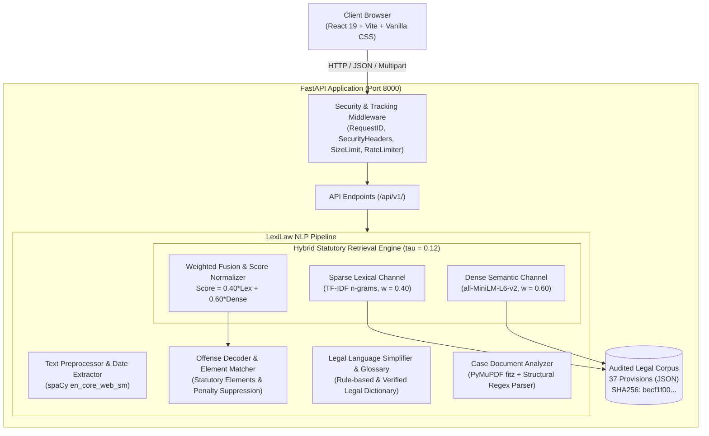

# HaqDwaar (LexiLaw) — Legal Information & NLP Statutory Retrieval System

[](https://opensource.org/licenses/MIT)
[](https://www.python.org/)
[](https://fastapi.tiangolo.com/)
[](https://react.dev/)
[](https://pytest.org/)

HaqDwaar (LexiLaw) is an offline-first, dual-channel statutory retrieval and legal-NLP assistance system tailored for Indian criminal, cyber, and procedural law. Built as an academic research and engineering project, the platform addresses the significant legal transition in India from the historical **Indian Penal Code, 1860 (IPC)** to the **Bharatiya Nyaya Sanhita, 2023 (BNS)** (effective 1 July 2024), alongside the **Information Technology Act, 2000 (ITA)** and the **Digital Personal Data Protection Act, 2023 (DPDP)**.

---

## 1. System Architecture

LexiLaw follows a decoupled client-server architecture with an offline-first NLP processing pipeline:



---

## 2. Main Functional Modules

### Module 1: Legal Offense Decoder (`/api/v1/offense/analyze`)
- **Objective:** Ingests unstructured, natural-language incident narratives from ordinary citizens and identifies applicable statutory provisions across BNS, IPC, and IT Act.
- **Key Capabilities:**
  - Extracts temporal incident dates to respect the 1 July 2024 Indian criminal law transition boundary.
  - Generates top-$K$ candidate provisions with calibrated confidence scores ($\tau \ge 0.12$).
  - Evaluates statutory element satisfaction (e.g. *dishonest inducement*, *property transfer*, *unauthorized access*).
  - Explicitly detects civil, commercial, and out-of-scope disputes to prevent false criminal accusations.
  - Suppresses penalty exposure for uncommenced provisions (e.g., BNS Section 106(2)).

### Module 2: Legal Language Simplifier & Glossary (`/api/v1/legal-language/`)
- **Objective:** Bridges the communication gap between legalese and ordinary citizen comprehension.
- **Key Capabilities:**
  - **Bidirectional Transformation:** Converts formal legalese into plain English and vice versa using deterministic rule-based transformations.
  - **Authoritative Glossary:** Provides verified explanations, synonyms, and statutory provenance for Latin maxims and technical legal concepts (e.g., *mens rea*, *actus reus*, *cognizable offense*).

### Module 3: Case Document Analyzer (`/api/v1/legal-language/analyze-case` & `/api/v1/documents/extract`)
- **Objective:** Parses unstructured court judgments and FIR PDFs into structured legal intelligence.
- **Key Capabilities:**
  - Safe in-memory text extraction per page using PyMuPDF (`fitz` v1.28.0) with strict size ($10\text{ MB}$) and page count ($50$ pages) guards.
  - Extracts court metadata, procedural history, material facts, framed issues, ratio decidendi, and operative outcomes.

---

## 3. Retrieval Methodology & Mathematical Formulation

LexiLaw employs a **Dual-Channel Hybrid Fusion Retrieval Architecture** combining sparse lexical matching with dense semantic embeddings to balance exact statutory keyword recall with semantic narrative understanding.

### 3.1 Lexical Channel (Sparse TF-IDF)
The lexical channel calculates term frequency-inverse document frequency over unigrams and bigrams with sublinear term-frequency scaling:
$$\text{TF-IDF}(t, d, D) = (1 + \log(\text{tf}(t, d))) \cdot \log\left(\frac{1 + |D|}{1 + \text{df}(t, D)}\right)$$
Where lexical similarity between query narrative $q$ and provision $p$ is the cosine similarity:
$$S_{\text{lex}}(q, p) = \frac{\mathbf{v}_{\text{lex}}(q) \cdot \mathbf{v}_{\text{lex}}(p)}{\|\mathbf{v}_{\text{lex}}(q)\| \|\mathbf{v}_{\text{lex}}(p)\|}$$

### 3.2 Dense Semantic Channel (Transformer Embeddings)
The semantic channel utilizes `sentence-transformers/all-MiniLM-L6-v2` (384-dimensional dense vectors with mean pooling):
$$\mathbf{e}(q) = \text{Encoder}(q), \quad \mathbf{e}(p) = \text{Encoder}(p)$$
$$S_{\text{dense}}(q, p) = \frac{\mathbf{e}(q) \cdot \mathbf{e}(p)}{\|\mathbf{e}(q)\| \|\mathbf{e}(p)\|}$$

### 3.3 Hybrid Fusion Equation
Before fusion, scores across candidates are min-max normalized per channel:
$$\tilde{S}(q, p) = \frac{S(q, p) - \min_{p'} S(q, p')}{\max_{p'} S(q, p') - \min_{p'} S(q, p') + \epsilon}$$
The final composite relevance score $S_{\text{hybrid}}(q, p)$ is computed as:
$$S_{\text{hybrid}}(q, p) = w_{\text{lex}} \cdot \tilde{S}_{\text{lex}}(q, p) + w_{\text{dense}} \cdot \tilde{S}_{\text{dense}}(q, p)$$
- **Frozen Weights:** $w_{\text{lex}} = 0.40, \quad w_{\text{dense}} = 0.60$
- **Operating Cutoff Threshold:** $\tau = 0.12$
  $$\text{Candidates}(q) = \{ p \in \mathcal{C} \mid S_{\text{hybrid}}(q, p) \ge \tau \}$$

---

## 4. Legal Corpus Scope & Provenance

The knowledge base (`backend/data/legal_provisions.json`) is cryptographically fingerprinted:
- **Corpus SHA-256:** `becf1f001631bbdc301633df428b0cb541dca97fa45b1ad7cf05db8b1d0d00d0`
- **Total Provisions:** 37
  - **Bharatiya Nyaya Sanhita, 2023 (BNS):** 14 provisions (Theft, Extortion, CBT, Mischief, Forgery, Defamation, Intimidation, Voyeurism, Stalking, Modesty)
  - **Indian Penal Code, 1860 (IPC):** 14 historical benchmark counterpart provisions
  - **Information Technology Act, 2000 (ITA):** 8 cybercrime provisions (Sections 43, 66, 66B, 66C, 66D, 66E, 67, 67A)
  - **Digital Personal Data Protection Act, 2023 (DPDP):** 1 provisional record (Section 33, awaiting Board operationalization)

### Temporal Applicability Rule
- **Incidents before 1 July 2024:** Governed by IPC 1860.
- **Incidents on or after 1 July 2024:** Governed by BNS 2023.
- **Cyber offenses:** ITA 2000 applies across all dates alongside substantive penal provisions.

---

## 5. Measured Evaluation Performance

Results evaluated against the independent 35-scenario blind benchmark at frozen threshold $\tau = 0.12$:

| Metric | Hybrid Pipeline ($\tau = 0.12$) | TF-IDF Baseline | Relative Delta |
| :--- | :---: | :---: | :---: |
| **Mean Reciprocal Rank (MRR)** | **0.7683** | 0.3269 | **+135.0%** |
| **Precision@3** | **0.3462** | 0.1282 | **+170.0%** |
| **Precision@5** | **0.2154** | 0.0769 | **+180.1%** |
| **Recall@5** | **0.9423** | 0.3846 | **+145.0%** |
| **Recall@10** | **0.9808** | 0.3846 | **+155.0%** |
| **No-Match Accuracy (Specificity)** | **22.22%** (2/9) | **55.56%** (5/9) | -60.0% |
| **Out-of-Scope False Positive Rate** | **77.78%** (7/9) | **44.44%** (4/9) | +75.0% |

*Denominators:* P@K uses $K$ (3 or 5); Recall@K uses ground-truth relevant count $|R_q|$ ($N=26$ positive queries); No-match accuracy is evaluated strictly on out-of-scope civil scenarios ($N=9$).

---

## 6. Installation & Quick Start

### Prerequisites
- Python 3.11+ (tested on Python 3.13.11)
- Node.js 18+ & npm
- Git

### 1. Clone the Repository
```bash
git clone https://github.com/Jalaj-01/HaqDwaar.git
cd HaqDwaar
```

### 2. Backend Setup
```bash
# Navigate to backend and install dependencies
cd backend
pip install -r requirements.txt

# Download spaCy English language pipeline
python -m spacy download en_core_web_sm

# Start the FastAPI server (runs on http://127.0.0.1:8000)
python -m uvicorn main:app --host 127.0.0.1 --port 8000
```

### 3. Frontend Setup
```bash
# In a new terminal, navigate to frontend
cd frontend
npm install

# Start the Vite development server (runs on http://127.0.0.1:5173)
npm run dev
```

### 4. Verification
Open your browser and navigate to:
- **Web UI:** `http://127.0.0.1:5173/`
- **Interactive API Documentation:** `http://127.0.0.1:8000/docs`
- **System Health Endpoint:** `http://127.0.0.1:8000/health`

---

## 7. Running Quality Gates & Tests

### Backend Unit & Integration Tests (137 Tests)
```bash
pytest backend/tests/ -v
```

### Evaluation Benchmark Tests (33 Tests)
```bash
pytest backend/tests/test_evaluation.py -v
```

### Frontend Linter
```bash
cd frontend
npm run lint
```

### Frontend Production Build
```bash
cd frontend
npm run build
```

---

## 8. Academic Deliverables & System Specifications

- **Dual-Channel Retrieval Engine:** Sparse TF-IDF ($w=0.40$) fused with dense MiniLM ($w=0.60$) at calibrated threshold $\tau = 0.12$.
- **Temporal Transition Framework:** Strict non-retroactivity under Article 20(1) distinguishing IPC 1860 (pre-July 2024) and BNS 2023 (post-July 2024).
- **Element-Grounded Explanations:** Real-time fact-to-element mapping with explicit unestablished element flagging and neutral follow-up prompts.
- **Audited Statutory Corpus:** 37 canonical provisions spanning BNS, IPC, IT Act, and DPDP Act fingerprinted with SHA-256 integrity.

---

## 9. Academic Disclaimer

> **IMPORTANT NOTICE:** LexiLaw is an academic research and engineering prototype developed for informational and educational purposes. It does not provide formal legal representation, opinions, or actionable counsel. Statutory interpretations should be independently verified with qualified advocates and official gazette notifications.
