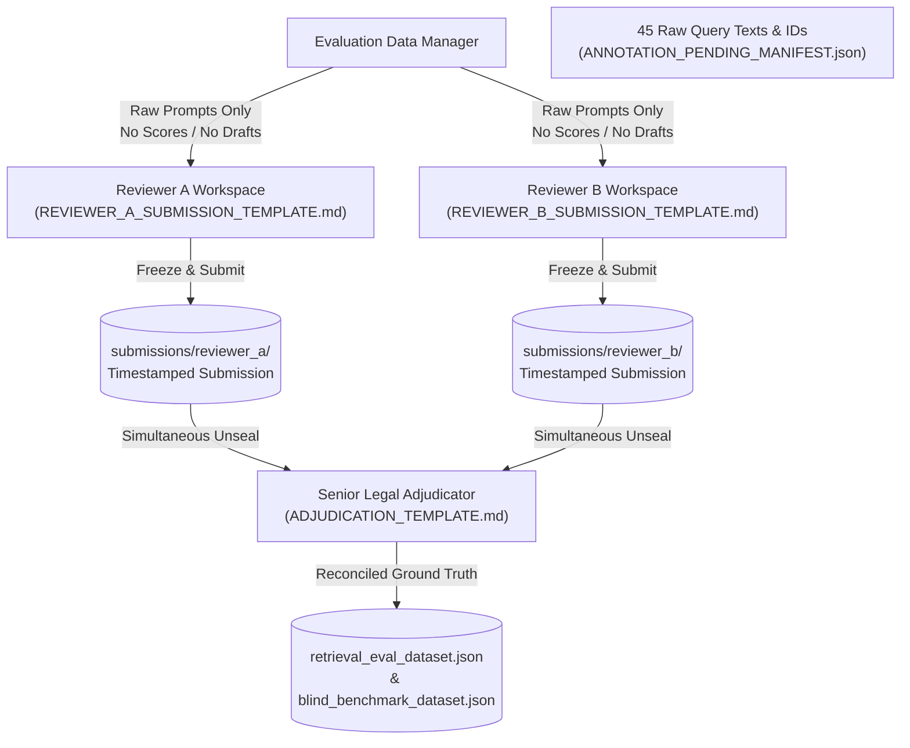

# LexiLaw — Practical Reviewer Instruction Sheet

**Document Version:** 1.0.0  
**Effective Date:** October 17, 2026  
**Audience:** Independent Legal Reviewers (Reviewer A & Reviewer B) and Senior Legal Adjudicators  
**Scope:** Review and adjudication of 45 pending evaluation queries:
- **10 Original Quarantined Records:** `DEV_026`–`DEV_030` and `TEST_016`–`TEST_020` in `retrieval_eval_dataset.json`
- **35 Independent Blind Scenarios:** `BLIND_001`–`BLIND_035` in `blind_benchmark_dataset.json`
**Corpus Fingerprint:** 37 provisions (SHA-256: `becf1f001631bbdc301633df428b0cb541dca97fa45b1ad7cf05db8b1d0d00d0`)  
**Operating Threshold Context:** Frozen retrieval cutoff $\tau = 0.12$.

---

## 1. Ethical Commitments & Independent Blinding Protocol

To preserve scientific rigor, academic integrity, and evidentiary reproducibility, all reviewers must adhere to the following **Five Non-Negotiable Review Principles**:

```
+---------------------------------------------------------------------------------------------------+
|                                  FIVE INDEPENDENCE PRINCIPLES                                     |
+-----------------------------+---------------------------------------------------------------------+
| 1. Air-Gapped Review        | Reviewer A and Reviewer B must work completely independently.        |
|                             | Neither reviewer may view the other's submissions before freeze.    |
+-----------------------------+---------------------------------------------------------------------+
| 2. Total Model Blinding     | Reviewers must NOT be provided model candidate rankings, similarity |
|                             | scores, or PENDING_ANNOTATION_REVIEW.md prior to final submission.  |
+-----------------------------+---------------------------------------------------------------------+
| 3. Zero Fact Extrapolation  | Reviewers must base decisions strictly on the stated narrative.     |
|                             | Do NOT assume or invent unmentioned genders, dates, or mental states.|
+-----------------------------+---------------------------------------------------------------------+
| 4. Primary Statutory Proof  | Similarity scores are NEVER legal proof. All decisions must cite     |
|                             | verified primary statutory text from India Code or Official Gazette.|
+-----------------------------+---------------------------------------------------------------------+
| 5. Preserved Audit Trail    | All raw reviewer submission sheets must be cryptographically hashed |
|                             | and archived in the repository before senior adjudication commences. |
+-----------------------------+---------------------------------------------------------------------+
```

---

## 2. Directory of Exact Valid Labels (The 37-Provision Audited Corpus)

Reviewers may **only** assign provision IDs that exist in the active 37-provision audited knowledge base (`backend/data/legal_provisions.json`). Assigning an unindexed section ID will fail automated schema validation.

### 2.1 Information Technology Act, 2000 (ITA) — 8 Continuous Provisions
*Applies continuously across both pre-July 2024 and post-July 2024 eras for cyber and electronic offenses.*

| Provision ID | Act Name | Section | Official Statutory Title | Operational Era |
| :--- | :--- | :--- | :--- | :--- |
| `ITA_2000_S43` | Information Technology Act, 2000 | Section 43 | Penalty and compensation for damage to computer system | 2000-10-17 $\rightarrow$ Present |
| `ITA_2000_S66` | Information Technology Act, 2000 | Section 66 | Computer related offences (hacking, dishonest/fraudulent acts) | 2009-10-27 $\rightarrow$ Present |
| `ITA_2000_S66B` | Information Technology Act, 2000 | Section 66B | Punishment for dishonestly receiving stolen computer resource | 2009-10-27 $\rightarrow$ Present |
| `ITA_2000_S66C` | Information Technology Act, 2000 | Section 66C | Punishment for identity theft (stolen passwords, digital signatures) | 2009-10-27 $\rightarrow$ Present |
| `ITA_2000_S66D` | Information Technology Act, 2000 | Section 66D | Punishment for cheating by personation by using computer resource | 2009-10-27 $\rightarrow$ Present |
| `ITA_2000_S66E` | Information Technology Act, 2000 | Section 66E | Punishment for violation of privacy (bodily privacy capture/transmit)| 2009-10-27 $\rightarrow$ Present |
| `ITA_2000_S67` | Information Technology Act, 2000 | Section 67 | Publishing or transmitting obscene material in electronic form | 2000-10-17 $\rightarrow$ Present |
| `ITA_2000_S67A` | Information Technology Act, 2000 | Section 67A | Publishing or transmitting sexually explicit act in electronic form | 2009-10-27 $\rightarrow$ Present |

### 2.2 Bharatiya Nyaya Sanhita, 2023 (BNS) — 14 Modern Provisions
*Enforceable strictly for offenses committed on or after 1 July 2024 (Act No. 45 of 2023, commenced w.e.f. 1 July 2024).*

| Provision ID | Act Name | Section | Official Statutory Title | Operational Era |
| :--- | :--- | :--- | :--- | :--- |
| `BNS_2023_S77` | Bharatiya Nyaya Sanhita, 2023 | Section 77 | Voyeurism | 2024-07-01 $\rightarrow$ Present |
| `BNS_2023_S78` | Bharatiya Nyaya Sanhita, 2023 | Section 78 | Stalking | 2024-07-01 $\rightarrow$ Present |
| `BNS_2023_S79` | Bharatiya Nyaya Sanhita, 2023 | Section 79 | Word, gesture or act intended to insult the modesty of a woman | 2024-07-01 $\rightarrow$ Present |
| `BNS_2023_S106_SUB2_UNCOMMENCED` | Bharatiya Nyaya Sanhita, 2023 | Section 106(2) | Hit-and-run fatal collision without reporting to police | **UNCOMMENCED** |
| `BNS_2023_S303` | Bharatiya Nyaya Sanhita, 2023 | Section 303 | Theft | 2024-07-01 $\rightarrow$ Present |
| `BNS_2023_S308` | Bharatiya Nyaya Sanhita, 2023 | Section 308 | Extortion | 2024-07-01 $\rightarrow$ Present |
| `BNS_2023_S316` | Bharatiya Nyaya Sanhita, 2023 | Section 316 | Criminal breach of trust | 2024-07-01 $\rightarrow$ Present |
| `BNS_2023_S318` | Bharatiya Nyaya Sanhita, 2023 | Section 318 | Cheating | 2024-07-01 $\rightarrow$ Present |
| `BNS_2023_S319` | Bharatiya Nyaya Sanhita, 2023 | Section 319 | Cheating by personation | 2024-07-01 $\rightarrow$ Present |
| `BNS_2023_S324` | Bharatiya Nyaya Sanhita, 2023 | Section 324 | Mischief | 2024-07-01 $\rightarrow$ Present |
| `BNS_2023_S336` | Bharatiya Nyaya Sanhita, 2023 | Section 336 | Forgery | 2024-07-01 $\rightarrow$ Present |
| `BNS_2023_S340` | Bharatiya Nyaya Sanhita, 2023 | Section 340 | Using as genuine a forged document or electronic record | 2024-07-01 $\rightarrow$ Present |
| `BNS_2023_S351` | Bharatiya Nyaya Sanhita, 2023 | Section 351 | Criminal intimidation | 2024-07-01 $\rightarrow$ Present |
| `BNS_2023_S356` | Bharatiya Nyaya Sanhita, 2023 | Section 356 | Defamation | 2024-07-01 $\rightarrow$ Present |

### 2.3 Indian Penal Code, 1860 (IPC) — 14 Historical Counterpart Provisions
*Enforceable strictly for historical offenses committed on or before 30 June 2024 (preserved under Section 358(2) BNS savings).*

| Provision ID | Act Name | Section | Official Statutory Title | Operational Era |
| :--- | :--- | :--- | :--- | :--- |
| `IPC_1860_S354C` | Indian Penal Code, 1860 | Section 354C | Voyeurism | 2013-02-03 $\rightarrow$ 2024-06-30 |
| `IPC_1860_S354D` | Indian Penal Code, 1860 | Section 354D | Stalking | 2013-02-03 $\rightarrow$ 2024-06-30 |
| `IPC_1860_S379` | Indian Penal Code, 1860 | Section 379 | Punishment for theft | 1862-01-01 $\rightarrow$ 2024-06-30 |
| `IPC_1860_S384` | Indian Penal Code, 1860 | Section 384 | Punishment for extortion | 1862-01-01 $\rightarrow$ 2024-06-30 |
| `IPC_1860_S406` | Indian Penal Code, 1860 | Section 406 | Punishment for criminal breach of trust | 1862-01-01 $\rightarrow$ 2024-06-30 |
| `IPC_1860_S419` | Indian Penal Code, 1860 | Section 419 | Punishment for cheating by personation | 1862-01-01 $\rightarrow$ 2024-06-30 |
| `IPC_1860_S420` | Indian Penal Code, 1860 | Section 420 | Cheating and dishonestly inducing delivery of property | 1862-01-01 $\rightarrow$ 2024-06-30 |
| `IPC_1860_S426` | Indian Penal Code, 1860 | Section 426 | Punishment for mischief | 1862-01-01 $\rightarrow$ 2024-06-30 |
| `IPC_1860_S465` | Indian Penal Code, 1860 | Section 465 | Punishment for forgery | 1862-01-01 $\rightarrow$ 2024-06-30 |
| `IPC_1860_S468` | Indian Penal Code, 1860 | Section 468 | Forgery for purpose of cheating | 1862-01-01 $\rightarrow$ 2024-06-30 |
| `IPC_1860_S471` | Indian Penal Code, 1860 | Section 471 | Using as genuine a forged document or electronic record | 1862-01-01 $\rightarrow$ 2024-06-30 |
| `IPC_1860_S500` | Indian Penal Code, 1860 | Section 500 | Punishment for defamation | 1862-01-01 $\rightarrow$ 2024-06-30 |
| `IPC_1860_S506` | Indian Penal Code, 1860 | Section 506 | Punishment for criminal intimidation | 1862-01-01 $\rightarrow$ 2024-06-30 |
| `IPC_1860_S509` | Indian Penal Code, 1860 | Section 509 | Word, gesture or act intended to insult modesty of woman | 1862-01-01 $\rightarrow$ 2024-06-30 |

### 2.4 Provisional / Uncommenced Enactments — 1 Research Provision
*In the index for research discovery, but strictly prohibited from serving as enforceable penal ground truth.*

| Provision ID | Act Name | Section | Official Statutory Title | Operational Status |
| :--- | :--- | :--- | :--- | :--- |
| `DPDP_2023_S33_PROVISIONAL` | Digital Personal Data Protection Act, 2023 | Section 33 | Financial penalties for data protection breaches | **PROVISIONAL** (Uncommenced) |

---

## 3. Approved Temporal Applicability Rules

Under **Article 20(1) of the Constitution of India**, reviewers must adhere to the following mandatory temporal rules:

1. **Explicit Pre-July 2024 Incidents:**
   - Any query containing chronological markers prior to 1 July 2024 (e.g., *"In December 2023..."*, *"In 2022..."*) **must strictly be evaluated under the IPC 1860**.
   - Assigning a BNS 2023 provision to a pre-July 2024 act violates constitutional non-retroactivity and will be flagged as an automated error.
2. **Explicit Post-July 2024 Incidents:**
   - Any query containing chronological markers on or after 1 July 2024 (e.g., *"In August 2024..."*, *"In September 2024..."*) **must strictly be evaluated under the BNS 2023**.
   - Assigning a historical IPC provision to an act committed after BNS commencement is a temporal error.
3. **Specialized Statutes (IT Act 2000):**
   - Cyber offenses under the Information Technology Act, 2000 apply continuously across all dates. Temporal IPC/BNS boundaries do not alter IT Act provisions.
4. **Undated Incidents:**
   - If a prompt has no incident date (e.g. `DEV_028`, `DEV_030`), reviewers must record:
     - Under **Option A (Disjunctive Equivalence)**: Primary BNS ID and counterpart IPC ID.
     - Under **Option C (Contemporary Convention)**: Modern BNS ID with explicit notation that modern complaint filing is assumed.

---

## 4. Handling Uncommenced & Provisional Provisions

1. **BNS Section 106(2) (Hit-and-Run without Reporting):**
   - The Central Government excluded Section 106(2) from commencement via MHA Notification S.O. 850(E).
   - *Rule:* If a query describes a fatal road accident where the driver fled without reporting, reviewers **must not** assign `BNS_2023_S106_SUB2_UNCOMMENCED` as active ground truth. It must be marked `expected_no_match: true` or assigned to commenced negligence provisions (IPC 304A / BNS 106(1)) with an explicit note.
2. **DPDP Act Section 33 (Data Protection Penalties):**
   - A corporate cloud data breach or customer list leak (`BLIND_033`) cannot be assigned `DPDP_2023_S33_PROVISIONAL` as ground truth. The validator will fail if this provisional ID is marked as reviewed ground truth.

---

## 5. Out-of-Scope and Expected No-Match (`expected_no_match`) Criteria

Reviewers must set `expected_no_match: true` with `relevant_provision_ids: []` if and only if the scenario satisfies one of the following criteria:

1. **Exclusively Civil or Commercial Dispute:**
   - Contractual delays, vendor refunds, tenancy deposit withholdings for property repainting, banking fees, or consumer warranty dissatisfaction.
   - *Legal Test:* Criminal cheating requires proof of fraudulent intent *at the inception* of the transaction. Mere subsequent failure to perform is a civil breach of contract.
2. **Specialized Legislation Outside Indexed Corpus:**
   - Commercial trademark counterfeiting falls under the Trade Marks Act 1999 (Sections 102–104). Because the Trade Marks Act is outside the 37 indexed provisions, it must be marked `expected_no_match: true`.
3. **Lawful Activity Protected under Fundamental Rights:**
   - Taking photographs of a commercial storefront or crowded street from a public sidewalk is constitutionally protected under Article 19(1)(a) and does not violate voyeurism or privacy laws.
4. **Absence of Criminal Intent (*Mens Rea*):**
   - Explicitly labeled parody or satire on social media lacks the fraudulent deceptive intent required for cheating by personation under Section 66D IT Act.

---

## 6. Factual Ambiguity, Missing Statutory Ingredients & Preserving Uncertainty

Reviewers must strictly avoid **fact extrapolation**:
- If a statute has a substantive personal attribute requirement (e.g., **BNS Section 78** / **IPC Section 354D** requiring a *male perpetrator* and *female victim*), and the narrative is gender-neutral (`DEV_030`):
  - Do NOT assume the victim is female or the perpetrator is male.
  - Reviewers must document the factual gap under **"Unresolved Ambiguities & Factual Gaps"**.
  - If the missing element prevents establishing the offense, classify as `expected_no_match: true` or document an explicit qualified legal hypothesis.

---

## 7. Mandatory Authoritative Citation Standards

Every assigned provision ID must be accompanied by an independently verified primary source citation:
- **Mandatory Repositories:**
  - India Code Legislative Portal: `https://www.indiacode.nic.in`
  - The Gazette of India: `https://egazette.gov.in`
  - Supreme Court Reports (SCR) or Supreme Court Cases (SCC)
- **Mandatory Submission Format:**
  `[Act Name, Year] | Section [Number] | [India Code URL or Gazette Notification Number] | [Key Statutory Ingredient Verified]`
- **Strict Prohibition:** Model retrieval scores, cosine similarities, or AI outputs **must NEVER** be cited as legal proof.

---

## 8. Single-Label vs. Multi-Label Assignment Guidelines

1. **Single-Label Ground Truth:**
   - Permissible when a specific enactment (*lex specialis*) fully exhausts the criminal conduct without non-merging secondary crimes.
2. **Multi-Label Ground Truth:**
   - Mandatory when an act simultaneously satisfies the distinct ingredients of non-merging statutory offenses:
     - *Example (`DEV_026`):* Stolen password used to access email $\rightarrow$ Identity Theft (`ITA_2000_S66C`) AND Computer-Related Offense (`ITA_2000_S66`).
     - *Example (`TEST_017`):* Fabricated invoices to siphon funds $\rightarrow$ Forgery for Cheating (`IPC_1860_S468`), Using Forged Record (`IPC_1860_S471`), and Cheating (`IPC_1860_S420`).

---

## 9. Independent Submission Workflow & Blinding Architecture

To prevent contamination and cognitive anchoring:



1. **Data Manager Distribution:** Reviewers A and B receive only their isolated submission templates containing the prompt narratives and query IDs.
2. **Reviewer Submission Freeze:** Both reviewers independently fill out and submit their markdown submission forms.
3. **Simultaneous Unsealing:** Only after both Reviewer A and Reviewer B submissions are frozen and archived does the Senior Adjudicator unseal both forms to populate the Reconciliation Table.

---

## 10. Inter-Annotator Agreement Calculation & Adjudication Protocol

Because legal statutory evaluation involves **multi-label sets** and a **binary out-of-scope flag**, inter-annotator agreement must be calculated using three complementary metrics:

### 10.1 Binary Out-of-Scope Agreement (Cohen's Kappa $\kappa$)
Construct a $2 \times 2$ contingency table on `expected_no_match` (True vs. False):
$$\kappa = \frac{P_o - P_e}{1 - P_e}$$
Where $P_o$ is observed agreement, and $P_e$ is expected chance agreement.

### 10.2 Multi-Label Set Agreement (Mean Pairwise Jaccard Index)
For each query $q$, compare Reviewer A's provision set $A_q$ and Reviewer B's provision set $B_q$:
$$J(A_q, B_q) = \begin{cases} 1.0 & \text{if } A_q = \emptyset \text{ and } B_q = \emptyset \\ \frac{|A_q \cap B_q|}{|A_q \cup B_q|} & \text{otherwise} \end{cases}$$
The dataset agreement score is the macro-average: $\bar{J} = \frac{1}{N} \sum_{q=1}^N J(A_q, B_q)$.

### 10.3 Exact-Set Agreement Ratio
The proportion of queries where $A_q$ and $B_q$ are identical sets and `expected_no_match` matches:
$$\text{Exact Agreement} = \frac{1}{N} \sum_{q=1}^N \mathbb{I}(A_q == B_q \land \text{NoMatch}_A == \text{NoMatch}_B)$$

### 10.4 Disagreement Taxonomy & Adjudication Recording
When $J(A_q, B_q) < 1.0$, the Senior Adjudicator records the disagreement category and provides a reasoned statutory analysis in [`ADJUDICATION_TEMPLATE.md`](file:///g:/NLP/New/backend/evaluation/annotation_workflow/ADJUDICATION_TEMPLATE.md):
- **Category 1 (Polarity Conflict):** One reviewer marked in-scope; the other marked out-of-scope.
- **Category 2 (Set Granularity Disagreement):** One reviewer assigned a single provision (e.g. `[66C]`), while the other assigned an overlapping set (`[66C, 66]`).
- **Category 3 (Temporal Mismatch):** One reviewer assigned BNS; the other assigned IPC for an undated prompt.
- **Category 4 (Substantive Offense Conflict):** Reviewers selected entirely different penal chapters (e.g. Extortion vs Criminal Intimidation).
